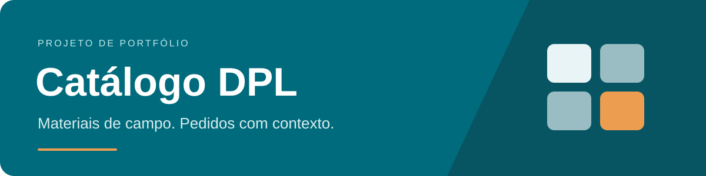

  

> Apresentação pública de portfólio. Código-fonte privado e sem disponibilização de acesso ao sistema.

## Um pedido começa pela especificação do material

Desenvolvi o Catálogo DPL para a operação da DPL, ligada à EQTL no setor de energia elétrica. O sistema reúne a consulta de EPIs, ferramentas e materiais de rede, a escolha das variantes e o fechamento do pedido em PDF.

Um exemplo do fluxo: buscar um capacete, escolher a cor, definir a quantidade e indicar se a compra é programada ou urgente. Essas informações seguem juntas no pedido, com o código do material e sua unidade.

## Veja o fluxo no vídeo

**▶ Clique na imagem para abrir a demonstração em vídeo.**

*Demonstração do lançamento, em outubro de 2026: busca, escolha de variante, carrinho, classificação da compra e PDF.*

## O que implementei

- **Busca para identificar o item:** nome, sinônimo, código DPL e C.A. (Certificado de Aprovação do EPI), além da navegação por categorias como aterramento, rede elétrica e proteção individual.
- **Especificação antes da compra:** seleção de variantes, tamanhos e quantidades, com revisão no carrinho.
- **Classificação da compra:** Programada, Mobilização, Urgente ou Emergente, registrada junto ao pedido.
- **Fechamento autenticado:** registro do pedido, histórico e PDF com os materiais solicitados.
- **Manutenção pela gestão:** cadastro de produtos, imagens e preços de referência.

## Decisões que sustentam o fluxo

O carrinho serve para preparar e revisar a solicitação; o fechamento exige autenticação. A estimativa é calculada no servidor, e o pedido preserva os preços do momento do fechamento. Assim, uma atualização posterior do catálogo não reescreve o pedido antigo.

A gestão mantém produtos e preços sem exigir uma alteração no código para cada atualização operacional.

## Tecnologias

| Camada | Escolha |
| --- | --- |
| Interface | HTML, CSS e JavaScript |
| Servidor | Node.js e funções na Vercel |
| Dados e autenticação | PostgreSQL e Supabase |
| Publicação | Vercel |

## Sobre esta apresentação

Este repositório contém apenas a descrição, o vídeo e as imagens do projeto. Não inclui código da aplicação, credenciais, instruções de acesso ou dados de pedidos e usuários.

**Desenvolvido por Marco Simões.**
